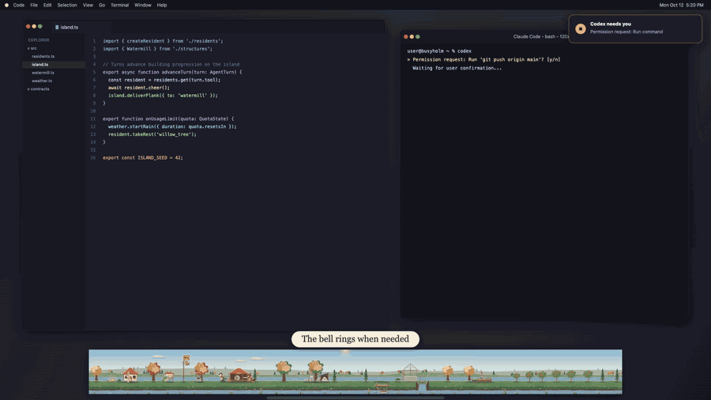

# Busyholm

[](https://github.com/draarivpatel-ui/busyholm/releases/tag/v0.1.0)

**[Watch the full demo video](https://github.com/draarivpatel-ui/busyholm/releases/tag/v0.1.0)**


A cozy papercut river island that lives along the bottom of your screen and grows from the activity of your AI coding agents. Each agent session becomes a small resident (a beaver, an otter, a hare, a hedgehog) that works on the island while the agent works. When an agent needs you, a resident rings the bell and raises a flag. Finished work becomes buildings, so a few weeks of coding leaves you with a village.


## Features

- **A strip along the bottom of the screen.** It floats above other windows without stealing focus, is click-through except where a resident or object is, and hides itself while another app is fullscreen.
- **Real agent activity.** Collectors read Claude Code, Codex and OpenCode activity (hooks, status line, transcripts and activity logs). Antigravity CLI is supported at a basic level.
- **Needs-you alerts.** A bell, a flag and an optional notification when an agent is waiting for a permission or an answer.
- **A world that grows.** A deterministic progression engine turns daily counts (completed turns, working time, active days) into planks, stone and seeds, and those into 12 structures and 24 decorations. Nothing rewards answering faster.
- **Usage limits as weather.** The five-hour and weekly limit usage that the agents report shows up as sky and clouds.
- **Ambient mode.** A fullscreen diorama view you open from the tray or with a shortcut.
- **Papercut art, drawn in code.** There are no third-party art assets. The one bundled font, Fraunces, is under the SIL Open Font License.
- **Private by construction.** Busyholm reads the agents' activity to count events and states. It never keeps, shows or sends prompts, replies, code, file paths or credentials. There are no outbound network connections and no telemetry; the only listener is on loopback. The repository includes canary tests and an offline verification harness that enforce this (see "Privacy" below).

## Status

Early software, version 0.1.

| Platform | State |
|---|---|
| macOS | The first target. Builds are **unsigned and not notarised**, so Gatekeeper will warn on first launch. |
| Windows | Compiles and has an acceptance script, but has not been run on a real Windows desktop. |
| Linux | X11 only, experimental; the strip is withheld on window managers where click-through fails. Wayland has no strip yet (the details window is the fallback). |

## Requirements

- macOS 11 or newer (Apple silicon or Intel).
- Node.js 22.18 or newer and npm.
- Rust 1.90 or newer (for the app; the collector crates need 1.85). `rustup` is the easiest way.
- Xcode Command Line Tools on macOS (`xcode-select --install`).
- Optional, for the browser tests only: `playwright-core` 1.64.0, `axe-core` 4.14.0 and a Chrome or Chromium install.

If `cargo` is not on your PATH, `source tools/env.sh` adds the usual Homebrew and `~/.cargo` locations for the current shell.

## Build and run

```sh
npm ci                        # root workspaces: contracts, world, ui
(cd world/art && npm ci)      # pinned esbuild, used by the renderer and ui builds
(cd app && npm ci)            # pinned Tauri CLI

cd app
npm run dev                   # debug build; replays synthetic fixtures, no agents needed
npm run build                 # release build for this OS (adds the real collector and the hook shim)
npm run build:app             # macOS only: Busyholm.app
```

`npm run dev` uses a mock collector by default, so you can see the strip, tray and ambient view before connecting anything. A release build contains the real collector and the `busyholm-hook` helper; onboarding then offers to connect Claude Code, Codex and OpenCode. Connecting makes targeted, previewed, backed-up edits to those agents' config files, and disconnecting removes exactly those entries again.

More detail on the shell, its command-line flags and per-OS behaviour is in [`app/README.md`](app/README.md). Packaging scripts with offline gates are in [`packaging/`](packaging/README.md).

### Try the world without the app

```sh
(cd world/demo && node tools/run-demo.mjs)    # prints a deterministic demo state as JSON
(cd world/art && npm run build)               # builds gallery.html, open it straight from disk
```

## Repository layout

| Folder | What it is |
|---|---|
| `app/` | Tauri v2 shell: windows, tray, notifications, collector supervision, connect and disconnect. |
| `collector/`, `collector-claude/`, `collector-codex/`, `collector-wp06/`, `sidecar/` | Rust crates: the collector core and state machine, the per-agent adapters (`collector-wp06` holds the OpenCode and Antigravity adapters, the OpenCode plugin and the process scanner), and the service binary. |
| `shim/` | `busyholm-hook`, the only hook transport. It strips content before sending allowlisted fields to the loopback receiver. |
| `installer/` | Previewed, backed-up, reversible edits of agent config files. |
| `contracts/` | The shared interfaces as JSON Schemas, TypeScript types and validators, and Rust types. |
| `world/` | `art/` (papercut art kit), `grow/` (progression engine), `renderer/` (Canvas 2D renderer), `demo/` (deterministic demo mode). |
| `ui/` | Tray popover, settings, details and onboarding pages. |
| `fixtures/`, `tools/` | Synthetic test data, the fixture generator, the privacy canary scanner and the offline verification harness. |

Code comments cite sections of an original design spec (written as "SPEC x.y") that is not part of this repository.

## Tests

```sh
npm test                                   # contract fixtures, type-check, privacy canary self-tests
cargo test --workspace --locked            # Rust crates against the same fixtures and their own suites
(cd collector-codex && cargo test)         # separate workspace
node app/scripts/assemble-frontend.mjs     # builds app/dist, which the app shell compiles in (placeholders are fine)
(cd app/src-tauri && cargo test)           # app shell logic (needs the WebKit build dependencies)
(cd world/grow && npm test)                # progression engine
(cd world/renderer && npm test)            # renderer, headless in virtual time
python3 tools/verify/run.py self-test      # negative controls for the verification harness
```

## Privacy

`npm run privacy:check -- <dir>` fails if any privacy canary appears in a file name or file content under `<dir>`. The agent-side fixtures plant a canary in every content field (prompts, replies, tool input, paths, ids, account fields), so a leak anywhere in the pipeline is caught. `python3 tools/verify/run.py all` additionally scans the source for networking APIs, samples real sockets while the shim and collector run, and checks third-party licences. See [`tools/verify/README.md`](tools/verify/README.md).

## License

MIT, see [`LICENSE`](LICENSE). The Fraunces font in `ui/src/fonts/` is under the SIL Open Font License 1.1 (`ui/src/fonts/OFL.txt`). Third-party licence texts that packages do not ship themselves are kept in `packaging/licence-overrides/`.
